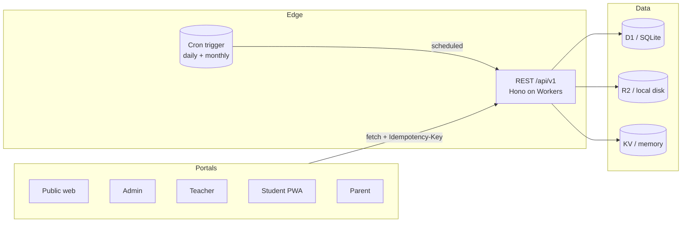

# Architecture

Monorepo (`apps/*`, `packages/*`). API-first: Hono routers per domain behind
`createApp(env, db)`; the `D1Like` interface (`prepare/bind/all/first/run`)
abstracts Cloudflare D1 (production) from `node:sqlite` (local dev/tests).

## Request pipeline

`requestId → language → env/db injection → CORS → rateLimit → authOptional →
idempotency → route (+ per-route requireAuth)`

Sub-app middleware is intentionally **per-route**, never `use('*')` on a
broadly-mounted router — a global guard once blocked the public certificate
endpoint, and the pattern is banned to keep public routes public (enforced by
`npm run audit`).

## Domain helpers (tenant safety)

`courseOrg` / `quizOrg` resolve `organization_id` server-side; `orgRole`,
`canAccessOrg`, and granular `roleHasPermission` checks run on every
org-scoped read/write. Parents are additionally constrained by `parent_links`.

## Data & storage

- IDs: UUID TEXT. Timestamps: ISO-8601 TEXT. Soft delete on identity/content roots.
- Crypto: WebCrypto PBKDF2 + HMAC JWT — zero native deps, Workers-compatible.
- `node:*` is loaded only via `process.getBuiltinModule` inside the local-only
  SQLite adapter (never bundled for Workers, never pre-resolved by test runners).
- Files: `putObject/getObject` switch on `STORAGE_DRIVER` (`local` fs vs R2
  binding). Uploads are recorded in `files` and downloaded only after an
  ownership/org check with a safe MIME allowlist.

## Frontends

Thin API consumers sharing `@lms/ui` (theme, token handling, toasts, modals,
offline queue with idempotency keys, push helper, service-worker updates).
No business logic duplicated. A contract script (`npm run contract`) verifies
every `/api/v1/*` path referenced by frontend sources resolves to a real
backend route.

## System map

## Flaky-test quarantine

A test that fails intermittently without a code change gets the issue label
`flaky` + a tracking note in `docs/troubleshooting.md`, a `test.fixme` skip
with the issue link after 3 documented flakes, and at most one retry in
Playwright config (`retries: 1`) — retries are a backstop, never the fix.
Known class: cold vite transforms on the first spec of a run (mitigated by
`e2e/global-setup.ts` warm-up); a repeat single-spec green run closes the case.
